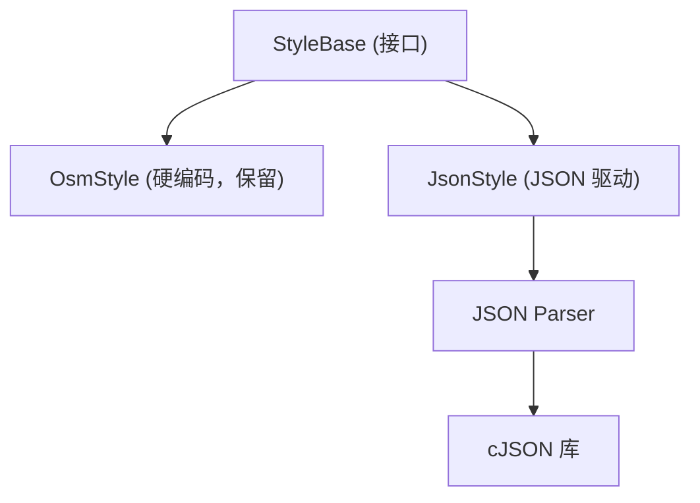

# JSON 样式配置设计方案

## 1. 目标

- 地图样式从硬编码改为 JSON 文件配置
- 支持多套皮肤（亮色/暗色/卫星/自定义），运行时切换
- JSON schema 简洁，嵌入式设备也能解析
- 保持 `StyleBase` 接口不变，`JsonStyle` 作为新的实现

## 2. JSON Schema 设计

### 2.1 整体结构

```json
{
    "name": "default-light",
    "version": 1,
    "background": { "color": "#E8E0D8" },
    "layers": {
        "<layer_name>": {
            "show": { ... },
            "fill": { ... },
            "stroke": { ... },
            "label": { ... }
        }
    }
}
```

### 2.2 颜色表示

统一用 `#RRGGBB` 或 `#RRGGBBAA` 字符串：

```json
{ "color": "#AAD3DF" }
{ "color": "#AAD3DF80" }
```

### 2.3 Layer 样式规则

每个 layer 可以有 `fill`、`stroke`、`label` 三种样式，每种样式支持按属性值匹配：

```json
{
    "layers": {
        "water_polygons": {
            "fill": {
                "color": "#AAD3DF"
            }
        },
        "streets": {
            "stroke": {
                "default": { "color": "#FFFFFF", "width": 1.0 },
                "match": {
                    "key": "kind",
                    "values": {
                        "motorway": { "color": "#FFA35C", "width": 3.0 },
                        "primary":  { "color": "#FFD88A", "width": 2.5 },
                        "secondary": { "color": "#FFFFFF", "width": 2.0 },
                        "residential": { "color": "#FFFFFF", "width": 1.2 },
                        "path":     { "color": "#EDEDED", "width": 0.8 }
                    }
                }
            }
        },
        "buildings": {
            "fill": { "color": "#D9D0C9" }
        },
        "land": {
            "fill": {
                "match": {
                    "key": "kind",
                    "values": {
                        "park":        { "color": "#CDEBB0" },
                        "forest":      { "color": "#CDEBB0" },
                        "hospital":    { "color": "#F3D3D3" },
                        "school":      { "color": "#EAD6C8" },
                        "residential": { "color": "#E0DFDF" }
                    }
                },
                "default": { "opacity": 0 }
            }
        }
    }
}
```

### 2.4 可见性控制

```json
{
    "layers": {
        "pois": {
            "show": {
                "min_zoom": 15,
                "match": {
                    "key": "kind",
                    "values": {
                        "hospital": { "min_zoom": 12 },
                        "school":   { "min_zoom": 13 },
                        "restaurant": { "min_zoom": 16 }
                    }
                }
            }
        }
    }
}
```

### 2.5 标签样式 + 图标映射

```json
{
    "layers": {
        "pois": {
            "label": {
                "color": "#333333",
                "icons": {
                    "key": "kind",
                    "values": {
                        "restaurant": "\uF2E7",
                        "hospital":   "\uF0F8",
                        "school":     "\uF549",
                        "hotel":      "\uF594",
                        "bank":       "\uF19C",
                        "bus_stop":   "\uF207",
                        "default":    "\uF3C5"
                    }
                }
            }
        }
    }
}
```

### 2.6 渲染顺序

```json
{
    "render_order": [
        "land", "water_polygons", "water_lines",
        "sites", "buildings", "streets", "bridges"
    ],
    "label_order": [
        "street_labels", "place_labels", "pois"
    ]
}
```

## 3. 实现设计

### 3.1 类结构



```cpp
// maptile/include/maptile/json_style.h

class JsonStyle : public StyleBase {
public:
    bool loadFromFile(const char* path);
    bool loadFromString(const char* json);

    bool getShowable(StyleType type, const std::string& layerName,
        const FeatureProp& prop, float zoom) override;
    bool getStyle(StyleType type, const std::string& layerName,
        const FeatureProp& prop, float zoom, StyleResult& result) override;

    const char** layerSequence() const;
    const char** labelSequence() const;

    const std::string& getName() const;

private:
    struct LayerStyle {
        struct MatchRule {
            std::string key;
            std::map<std::string, FillStyle> fillValues;
            std::map<std::string, StrokeStyle> strokeValues;
            std::map<std::string, std::string> iconValues;
            std::map<std::string, float> minZoomValues;
        };

        FillStyle defaultFill;
        StrokeStyle defaultStroke;
        LabelStyle defaultLabel;
        float minZoom = 0;
        MatchRule match;
        bool hasFill = false;
        bool hasStroke = false;
        bool hasLabel = false;
    };

    std::string _name;
    FillStyle _background;
    std::map<std::string, LayerStyle> _layers;
    std::vector<std::string> _renderOrder;
    std::vector<std::string> _labelOrder;

    // C string arrays for TileParser compatibility
    std::vector<const char*> _renderOrderCStr;
    std::vector<const char*> _labelOrderCStr;
};
```

### 3.2 JSON 解析库选择

| 库 | 大小 | 语言 | 嵌入式友好 |
|---|------|------|-----------|
| cJSON | ~20KB | C | ✅ 最佳，LVGL 已内置 |
| nlohmann-json | ~1MB | C++ | ❌ 太大 |
| RapidJSON | ~200KB | C++ | ⚠️ 可以 |

LVGL 没有内置 cJSON。方案：将 cJSON 作为 submodule 引入 `external/cjson`（[DaveGamble/cJSON](https://github.com/DaveGamble/cJSON)），它自带 CMakeLists.txt，直接 `add_subdirectory` 即可。cJSON 是单文件（`cJSON.c` + `cJSON.h`），~20KB，MIT 许可证。

## 4. 皮肤切换 UI

### 4.1 MapViewer 扩展

```cpp
class MapViewer {
    // ... 现有接口 ...

    // 皮肤管理
    bool addSkin(const char* name, const char* jsonPath);
    void setSkin(const char* name);
    const char* getCurrentSkin() const;

private:
    std::map<std::string, JsonStyle> _skins;
    lv_obj_t* _skinDropdown;  // LVGL dropdown 控件
};
```

### 4.2 UI 布局

```
┌─────────────────────────────────────────┐
│ [Z:14 R:0° (116.3,39.9)]  [▼ Light  ] │  ← 左上信息 + 右上皮肤下拉
│                                         │
│              地图区域                    │
│                                         │
│                              [Zoom ▐]  │  ← 右侧缩放滑条
│                                         │
│                              (Rot ◠)   │  ← 右下旋转圆弧
└─────────────────────────────────────────┘
```

### 4.3 预置皮肤

| 皮肤 | 文件 | 说明 |
|------|------|------|
| Light | `style_light.json` | 亮色主题（当前 OsmStyle 的配色） |
| Dark | `style_dark.json` | 暗色主题（深色背景 + 亮色道路） |
| Minimal | `style_minimal.json` | 极简（只有道路和水域） |

## 5. 示例 JSON 文件

### style_light.json

```json
{
    "name": "Light",
    "version": 1,
    "background": { "color": "#E8E0D8" },
    "render_order": ["land","water_polygons","water_lines","sites","buildings","streets","bridges"],
    "label_order": ["street_labels","place_labels","pois"],
    "layers": {
        "water_polygons": { "fill": { "color": "#AAD3DF" } },
        "water_lines": { "stroke": { "color": "#AAD3DF", "width": 1.5 } },
        "buildings": { "fill": { "color": "#D9D0C9" } },
        "streets": {
            "stroke": {
                "default": { "color": "#FFFFFF", "width": 1.0 },
                "match": { "key": "kind", "values": {
                    "motorway": { "color": "#FFA35C", "width": 3.0 },
                    "primary": { "color": "#FFD88A", "width": 2.5 }
                }}
            }
        },
        "land": {
            "fill": {
                "default": { "opacity": 0 },
                "match": { "key": "kind", "values": {
                    "park": { "color": "#CDEBB0" },
                    "hospital": { "color": "#F3D3D3" },
                    "school": { "color": "#EAD6C8" }
                }}
            }
        },
        "pois": {
            "label": {
                "color": "#333333",
                "icons": { "key": "kind", "values": {
                    "restaurant": "\uF2E7",
                    "hospital": "\uF0F8",
                    "default": "\uF3C5"
                }}
            }
        }
    }
}
```

### style_dark.json

```json
{
    "name": "Dark",
    "version": 1,
    "background": { "color": "#1A1A2E" },
    "render_order": ["land","water_polygons","water_lines","sites","buildings","streets","bridges"],
    "label_order": ["street_labels","place_labels","pois"],
    "layers": {
        "water_polygons": { "fill": { "color": "#16213E" } },
        "water_lines": { "stroke": { "color": "#16213E", "width": 1.5 } },
        "buildings": { "fill": { "color": "#2A2A3E" } },
        "streets": {
            "stroke": {
                "default": { "color": "#3A3A5E", "width": 1.0 },
                "match": { "key": "kind", "values": {
                    "motorway": { "color": "#E94560", "width": 3.0 },
                    "primary": { "color": "#E94560", "width": 2.5 }
                }}
            }
        },
        "land": {
            "fill": {
                "default": { "opacity": 0 },
                "match": { "key": "kind", "values": {
                    "park": { "color": "#1B3A2D" },
                    "hospital": { "color": "#3A1A2E" }
                }}
            }
        },
        "pois": {
            "label": {
                "color": "#CCCCCC",
                "icons": { "key": "kind", "values": {
                    "restaurant": "\uF2E7",
                    "default": "\uF3C5"
                }}
            }
        }
    }
}
```

## 6. 实施步骤

### Phase 1：JSON 解析基础

1. 添加 cJSON submodule（`external/cjson`）
2. 实现 `JsonStyle::loadFromFile()` / `loadFromString()`
3. 解析 background、render_order、label_order

### Phase 2：样式规则解析

4. 解析 fill/stroke/label 的 default 和 match 规则
5. 实现 `getStyle()` 的 match 查找逻辑
6. 实现 `getShowable()` 的 min_zoom 过滤

### Phase 3：皮肤切换

7. 创建 light/dark/minimal 三个 JSON 文件
8. MapViewer 添加 dropdown 控件
9. 切换皮肤时重新解析+刷新所有瓦片

### Phase 4：验证

10. 对比 JsonStyle(light) 和 OsmStyle 的渲染结果是否一致
11. 验证 dark 主题效果
12. 性能测试：JSON 解析耗时
