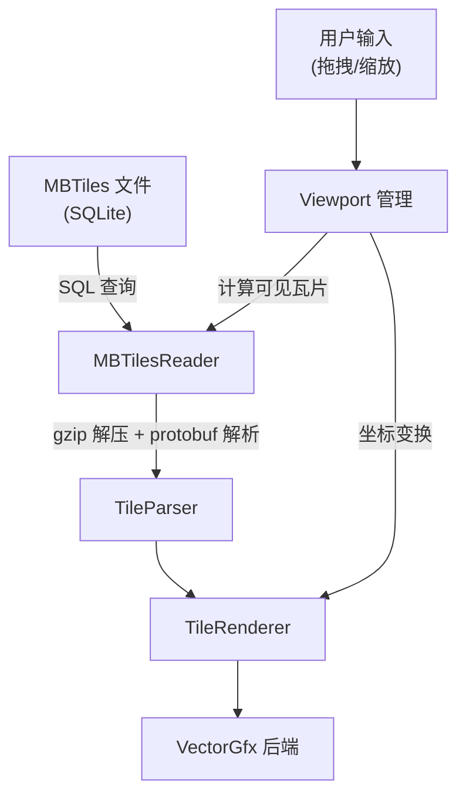
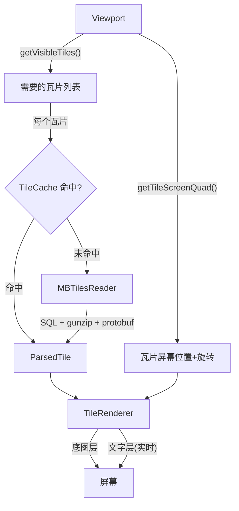

# 地图 Demo 设计方案

## 1. 数据源调研

### 1.1 免费矢量瓦片数据源对比

| 数据源 | 格式 | 许可证 | 离线支持 | 数据质量 | 适合嵌入式 |
|--------|------|--------|---------|---------|-----------|
| [OpenMapTiles](https://openmaptiles.org) | MBTiles (MVT/PBF) | ODbL + CC-BY | ✅ 可下载整个国家/城市 | 高，基于 OSM | ✅ |
| [Protomaps](https://protomaps.com) | PMTiles (MVT) | ODbL | ✅ 单文件存储 | 高，基于 OSM | ⚠️ PMTiles 格式需额外解析 |
| [OpenFreeMap](https://openfreemap.org) | 在线 MVT | ODbL | ❌ 仅在线 | 高 | ❌ |
| Mapbox | MVT | 商业许可 | ⚠️ 需 token | 最高 | ❌ 不免费 |

### 1.2 推荐方案：OpenMapTiles + MBTiles

理由：
- MBTiles 是 SQLite 数据库，嵌入式友好（SQLite 在 MCU 上有成熟移植）
- 瓦片数据就是标准 MVT/PBF 格式，和现有 protobuf 解析器完全兼容
- 可以按城市/国家下载，一个城市的数据通常只有几十 MB
- ODbL 许可证允许免费使用，只需标注 © OpenStreetMap contributors

### 1.3 MBTiles 格式说明

MBTiles 是一个 SQLite 数据库，核心表结构：

```sql
-- 元数据
CREATE TABLE metadata (name TEXT, value TEXT);

-- 瓦片数据
CREATE TABLE tiles (
    zoom_level INTEGER,
    tile_column INTEGER,
    tile_row INTEGER,
    tile_data BLOB  -- gzip 压缩的 MVT/PBF 数据
);
```

读取一个瓦片：
```sql
SELECT tile_data FROM tiles
WHERE zoom_level = 15 AND tile_column = 26977 AND tile_row = 12415;
```

注意：MBTiles 的 `tile_row` 使用 TMS 坐标系（Y 轴翻转），需要转换：
```
tms_y = (1 << zoom) - 1 - slippy_y
```

### 1.4 OpenMapTiles vs Mapbox 瓦片 Schema 差异

当前代码的样式系统（`MapStyle`）是基于 Mapbox 的 layer 命名写的（`road`、`water`、`building`、`landuse` 等）。OpenMapTiles 的 schema 和 Mapbox 有差异：

| 功能 | Mapbox Schema | OpenMapTiles Schema |
|------|--------------|-------------------|
| 道路 | `road` layer, `class` 属性 | `transportation` layer, `class` 属性 |
| 道路标签 | `road` layer 内 | `transportation_name` layer |
| 水域 | `water` layer | `water` layer（一致） |
| 建筑 | `building` layer | `building` layer（一致） |
| 土地利用 | `landuse` layer | `landuse` layer（一致） |
| 水系 | `waterway` layer | `waterway` layer（一致） |
| POI | `poi_label` layer | `poi` layer |
| 地名 | `place_label` layer | `place` layer |

主要差异在道路层（`road` → `transportation`）和标签层的命名。需要适配 `MapStyle` 或写一个新的 `OpenMapTilesStyle`。

## 2. Demo 功能设计

### 2.1 核心功能



### 2.2 模块划分

| 模块 | 职责 | 新增/复用 |
|------|------|---------|
| `MBTilesReader` | 从 MBTiles 文件读取瓦片数据 | 新增 |
| `TileCache` | 缓存已解析的瓦片，避免重复解析 | 新增 |
| `Viewport` | 管理视口（中心点、缩放级别、屏幕尺寸） | 新增 |
| `TileGrid` | 计算当前视口需要哪些瓦片 | 新增 |
| `MapView` | 组装以上模块，处理用户交互 | 新增 |
| `TileParser` | protobuf 解析 | 复用 |
| `TileRenderer` | 矢量渲染 | 复用 |
| `MapStyle` / `OsmStyle` | 样式系统 | 复用/适配 |

### 2.3 MBTilesReader 接口

```cpp
// maptile/include/maptile/mbtiles_reader.h

namespace MapTile {

class MBTilesReader {
public:
    bool open(const char* path);
    void close();

    // 读取原始瓦片数据（gzip 压缩的 PBF）
    bool getTileData(int zoom, int x, int y,
                     std::vector<uint8_t>& data);

    // 读取并解析为 ParsedTile
    bool getTile(int zoom, int x, int y,
                 StyleBase& style, ParsedTile& tile);

    // 元数据
    std::string getMetadata(const std::string& key);
    int getMinZoom();
    int getMaxZoom();

private:
    sqlite3* _db = nullptr;
};

} // namespace MapTile
```

### 2.4 Viewport（视口变换核心）

Viewport 是整个地图交互的数学核心，管理从地理坐标到屏幕像素的完整变换链，支持平移、缩放、旋转。

#### 坐标系定义

```
地理坐标 (WGS84)          Web Mercator (世界像素)         屏幕像素
  lon, lat        →        wx, wy              →        sx, sy
              Mercator投影                  视口变换(平移+缩放+旋转)
```

#### 变换矩阵

视口变换用一个 3x3 仿射矩阵表示，组合了平移、缩放、旋转：

```
                    ┌                     ┐
                    │ cos(θ)·s  -sin(θ)·s  tx │
    M_viewport  =   │ sin(θ)·s   cos(θ)·s  ty │
                    │    0          0       1  │
                    └                     ┘

    s  = 缩放因子（由 zoom 级别决定）
    θ  = 旋转角度（弧度）
    tx, ty = 平移偏移（屏幕像素）
```

世界像素 → 屏幕像素：`[sx, sy, 1]^T = M_viewport * [wx, wy, 1]^T`
屏幕像素 → 世界像素：`[wx, wy, 1]^T = M_viewport^(-1) * [sx, sy, 1]^T`

#### 接口设计

```cpp
// maptile/include/maptile/viewport.h

namespace MapTile {

struct GeoCoord {
    double lon, lat;
};

struct TileCoord {
    int x, y, z;
};

class Viewport {
public:
    void setScreenSize(int width, int height);
    void setTileSize(int size);  // 渲染分辨率，默认 256

    // 视口状态
    void setCenter(double lon, double lat);
    void setZoom(float zoom);
    void setRotation(float degrees);

    GeoCoord getCenter() const;
    float getZoom() const;
    float getRotation() const;

    // 交互操作（屏幕坐标系）
    void pan(float dx, float dy);                    // 拖拽平移
    void zoomAt(float sx, float sy, float delta);    // 以屏幕点为中心缩放
    void rotateAt(float sx, float sy, float degrees); // 以屏幕点为中心旋转

    // 坐标变换
    void geoToScreen(double lon, double lat, float& sx, float& sy) const;
    void screenToGeo(float sx, float sy, double& lon, double& lat) const;

    // 瓦片查询
    std::vector<TileCoord> getVisibleTiles() const;
    void getTileScreenQuad(const TileCoord& tile, float quad[8]) const;
    // quad: 4个顶点的屏幕坐标 [x0,y0, x1,y1, x2,y2, x3,y3]
    // 有旋转时瓦片在屏幕上是一个旋转的矩形

private:
    double _centerLon = 116.397;
    double _centerLat = 39.908;
    float _zoom = 14.0f;
    float _rotation = 0.0f;  // degrees
    int _screenWidth = 800;
    int _screenHeight = 600;
    int _tileSize = 256;
};

} // namespace MapTile
```

#### 旋转时的可见瓦片计算

无旋转时，可见瓦片是一个轴对齐矩形，直接算 min/max tile x/y 即可。

有旋转时，屏幕四个角映射到世界坐标后形成一个旋转矩形，需要取其 AABB（轴对齐包围盒）来确定需要加载的瓦片范围：

```
屏幕四角 → screenToGeo() → 4个地理坐标 → 转瓦片坐标 → 取 AABB → 遍历范围内瓦片
```

这会比无旋转时多加载一些瓦片（角落区域），但逻辑简单且正确。

### 2.5 TileCache

```cpp
namespace MapTile {

class TileCache {
public:
    void setCapacity(int maxTiles);  // 默认 64

    const ParsedTile* get(const TileCoord& coord) const;
    void put(const TileCoord& coord, ParsedTile&& tile);
    void clear();
};

} // namespace MapTile
```

### 2.6 MapView（Demo 主控）

```cpp
// example/map_view.h

class MapView {
public:
    MapView(MapTile::VectorGfx& gfx, MapTile::TextGfx& textGfx);

    bool loadMap(const char* mbtilesPath);
    void setScreenSize(int width, int height);
    void render();

    // 交互
    void onPan(float dx, float dy);
    void onZoom(float sx, float sy, float delta);
    void onRotate(float sx, float sy, float degrees);

private:
    MapTile::MBTilesReader _reader;
    MapTile::Viewport _viewport;
    MapTile::TileCache _cache;
    MapTile::OsmStyle _style;
    MapTile::VectorGfx& _gfx;
    MapTile::TextGfx& _textGfx;
};
```

### 2.7 交互控制（LVGL 组件）

使用 LVGL 原生组件控制地图，不直接接 SDL 事件：

| 控件 | 地图操作 | 说明 |
|------|---------|------|
| 地图区域 `LV_EVENT_PRESSING` | 平移 | `lv_indev_get_vect()` 获取拖拽增量 |
| `lv_slider` | 缩放 | 范围对应 zoom 级别（如 10~18） |
| `lv_arc` | 旋转 | 范围 0°~360°，拖动实时旋转 |

### 2.8 渲染流程



每帧渲染步骤：
1. `Viewport::getVisibleTiles()` 计算当前需要哪些瓦片
2. 对每个瓦片，从 cache 或 MBTilesReader 获取 ParsedTile
3. `Viewport::getTileScreenQuad()` 计算瓦片在屏幕上的位置（含旋转）
4. 设置 VectorGfx 的变换矩阵（缩放 + 旋转 + 平移）
5. `TileRenderer::render()` 渲染底图
6. 文字层单独渲染（不缓存，实时计算位置）

## 3. 数据获取方案

### 3.1 下载 OpenMapTiles 城市数据

方式一：使用 [Protomaps 的 planetiler](https://github.com/onthegomap/planetiler) 从 OSM PBF 生成 MBTiles：

```bash
# 下载北京区域的 OSM 数据
wget https://download.geofabrik.de/asia/china-latest.osm.pbf

# 用 planetiler 生成 MBTiles（需要 Java）
java -jar planetiler.jar --osm-path=china-latest.osm.pbf \
    --output=beijing.mbtiles \
    --bounds=116.1,39.7,116.7,40.1
```

方式二：直接下载预生成的 MBTiles（推荐，更简单）：

```bash
# 从 OpenMapTiles 下载（需要注册免费账号）
# https://openmaptiles.org/downloads/
# 选择 Asia → China → 下载 .mbtiles 文件
```

方式三：使用 `pmtiles` 工具从 Protomaps 提取：

```bash
# 下载 pmtiles CLI
# https://github.com/protomaps/go-pmtiles/releases

# 从 Protomaps 全球数据中提取北京区域
pmtiles extract https://build.protomaps.com/20240101.pmtiles \
    beijing.pmtiles --bbox=116.1,39.7,116.7,40.1

# 转换为 MBTiles（如果需要）
```

### 3.2 Demo 数据准备脚本

```bash
# tools/download_demo_data.sh

#!/bin/bash
# 下载北京区域的 OpenMapTiles 数据用于 demo

BBOX="116.1,39.7,116.7,40.1"  # 北京中心区域
OUTPUT="example/resource/beijing.mbtiles"

echo "Downloading Beijing area tiles..."
# 使用 planetiler 或其他工具生成
# 具体命令取决于选择的工具链
```

## 4. 需要新增的依赖

| 依赖 | 用途 | 大小 | 嵌入式友好 |
|------|------|------|-----------|
| SQLite3 | 读取 MBTiles | ~500KB | ✅ 广泛用于嵌入式 |
| zlib / miniz | 解压 gzip 压缩的瓦片 | ~50KB | ✅ |

SQLite3 可以用系统库（`find_package`）或作为 submodule 引入单文件版本（`sqlite3.c` + `sqlite3.h`）。

## 5. 样式适配方案

### 5.1 方案：多 Schema 支持

创建 `OsmStyle` 类继承 `StyleBase`，适配 OpenMapTiles 的 layer 命名：

```cpp
// maptile/include/maptile/osm_style.h

class OsmStyle : public StyleBase {
    // transportation → 道路样式
    // transportation_name → 道路标签
    // water → 水域
    // building → 建筑
    // landuse → 土地利用
    // poi → POI 标签
    // place → 地名标签
};
```

`MapStyle`（现有）保留给 Mapbox schema，`OsmStyle` 用于 OpenMapTiles schema。`TileParser` 和 `TileRenderer` 不需要改动，因为它们只依赖 `StyleBase` 接口。

### 5.2 Layer 渲染顺序

OpenMapTiles 推荐的渲染顺序：

```cpp
static const char* osmLayerSequence[] = {
    "landuse", "water", "waterway",
    "building", "transportation",
    ""
};

static const char* osmLabelSequence[] = {
    "transportation_name", "place", "poi",
    ""
};
```

## 6. 实施步骤

### Phase 1：MBTiles 读取

1. 引入 SQLite3 依赖
2. 实现 `MBTilesReader`（SQL 查询 + gzip 解压）
3. 验证能正确读取 OpenMapTiles 数据

### Phase 2：样式适配

4. 实现 `OsmStyle`，适配 OpenMapTiles schema
5. 调整 `TileParser` 的 layer 序列配置

### Phase 3：视口管理

6. 实现 `Viewport`（经纬度 ↔ 瓦片坐标 ↔ 屏幕坐标）
7. 实现 `TileGrid`（计算可见瓦片）
8. 实现 `TileCache`（LRU 缓存）

### Phase 4：交互式 Demo

9. 实现 `MapView`，组装所有模块
10. 接入 SDL 鼠标事件（拖拽平移、滚轮缩放）
11. 多瓦片拼接渲染

### Phase 5：优化

12. 异步瓦片加载（后台线程解析）
13. 瓦片过渡动画（缩放时的淡入淡出）
14. 文字避让（标签不重叠）
