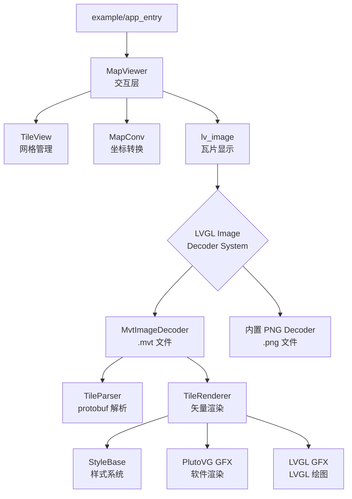
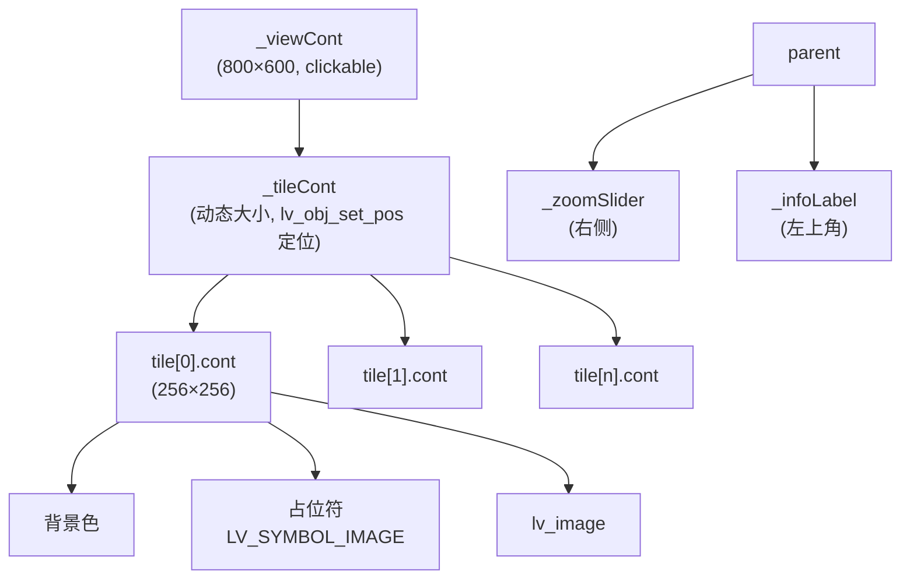
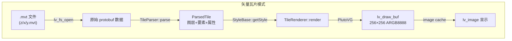
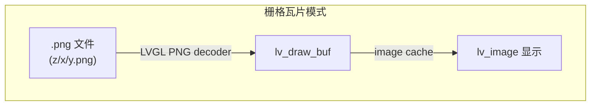

# 地图查看器架构概述

## 1. 项目定位

X-MAP 是一个面向嵌入式设备的矢量地图渲染框架，基于 LVGL 图形库。核心能力是将 MVT（Mapbox Vector Tile）格式的矢量瓦片实时渲染为可交互的地图界面。

设计目标：
- 作为子仓库嵌入 X-TRACK-EVO 等项目，替代其自维护的地图渲染模块
- 同时支持矢量瓦片（MVT）和栅格瓦片（PNG/BMP 等），上层无感切换
- 最小依赖：核心库仅需 protobuf，不强制依赖 SQLite/zlib

## 2. 整体架构



## 3. 核心模块

### 3.1 TileView（瓦片网格管理）

来自 X-TRACK-EVO，纯数学类，不依赖任何 UI 框架。

职责：
- 根据焦点像素坐标计算需要哪些瓦片
- 管理瓦片容器的大小和偏移
- 全部整数运算，无浮点误差，瓦片之间无缝隙

关键接口：
- `setFocusPos(x, y)` — 设置焦点的世界像素坐标
- `getTileRect()` — 获取当前瓦片容器的世界像素范围
- `getTilePos(i)` — 获取第 i 个瓦片的世界像素坐标
- `getOffset(point)` — 计算点在容器内的偏移

### 3.2 MapConv（坐标转换）

来自 X-TRACK-EVO，基于 Microsoft TileSystem 的 Web Mercator 投影。

职责：
- 经纬度 ↔ 世界像素坐标转换
- zoom level 切换时的坐标缩放（`convertPoint`）
- 可选的 GCJ-02 坐标偏移（中国地图纠偏）

### 3.3 MvtImageDecoder（MVT 文件解码器）

注册为 LVGL 自定义 image decoder，通过文件扩展名 `.mvt` 识别。

工作流程：
1. `lv_image_set_src(img, "A:maps/12/3372/1552.mvt")`
2. LVGL image system 调用 decoder 的 `info_cb` → 返回 256×256 ARGB8888
3. LVGL 检查 image cache，命中则直接使用
4. 未命中时调用 `open_cb`：
   - `lv_fs_open` 读取 .mvt 文件（原始 protobuf）
   - `TileParser::parse` 解析矢量数据
   - `TileRenderer::render` 通过 PlutoVG 渲染到 `lv_draw_buf`
   - `lv_image_decoder_add_to_cache` 加入缓存
5. 后续相同路径的请求直接命中缓存，不重复渲染

优势：
- MapViewer 不管理 draw_buf 生命周期，LVGL cache 自动回收
- 矢量瓦片和栅格瓦片对 MapViewer 完全透明
- 切换样式时 `lv_image_cache_drop(NULL)` 清缓存即可触发重新渲染

### 3.4 MapViewer（交互层）

组装 TileView + MapConv + LVGL 控件的 demo 应用。

UI 结构：


交互模型：
- 拖拽：`LV_EVENT_PRESSING` + `lv_indev_get_vect` → 更新 TileView focus → 重定位 tileCont
- 缩放：slider 值变化 → `MapConv::convertPoint` 坐标缩放 → 重建瓦片网格
- 不使用 LVGL 原生 scroll（避免边界 clamp 问题）

### 3.5 样式系统

支持 JSON 配置的地图样式，运行时可切换：

```cpp
// 切换样式
MvtImageDecoder::setStyle(darkStyle);  // 清缓存 + 下次渲染用新样式
```

预置样式：`style_light.json`（亮色）、`style_dark.json`（暗色）

## 4. 数据流





两种模式的区别仅在 decoder 层，MapViewer 只需要改 `setTilePathFormat` 的扩展名。

## 5. 目录结构

```
maptile/                          # 核心库
├── include/maptile/
│   ├── tile_view.h               # 瓦片网格管理 (from X-TRACK-EVO)
│   ├── map_conv.h                # 坐标转换 (from X-TRACK-EVO)
│   ├── tile_system.h             # Microsoft TileSystem
│   ├── gcj02.h                   # GCJ-02 坐标纠偏
│   ├── tile_parser.h             # MVT protobuf 解析
│   ├── tile_renderer.h           # 矢量渲染调度
│   ├── style.h / json_style.h    # 样式系统
│   ├── stroke_to_path.h          # 线条转路径算法
│   ├── mbtiles_reader.h          # MBTiles 读取 (可选)
│   ├── types.h                   # 基础类型
│   └── gfx/                      # 图形抽象接口
│       ├── vector_gfx.h
│       └── text_gfx.h
├── backend/
│   ├── lvgl/                     # LVGL 后端
│   │   ├── mvt_image_decoder.h   # MVT 文件 decoder
│   │   ├── lvgl_vector_gfx.h     # LVGL 矢量绘图
│   │   └── lvgl_text_gfx.h       # LVGL 文字绘图
│   └── plutovg/                  # PlutoVG 后端
│       ├── plutovg_gfx.h         # PlutoVG 矢量绘图
│       └── plutovg_text_gfx.h    # PlutoVG 文字绘图

example/                          # 示例应用
├── app_entry.cpp                 # 入口：初始化 decoder + MapViewer
├── map_viewer.h/cpp              # 交互式地图查看器
├── main.cpp                      # SDL 模拟器入口
└── resource/
    ├── maps/                     # MVT 瓦片文件 (z/x/y.mvt)
    ├── style_light.json          # 亮色样式
    ├── style_dark.json           # 暗色样式
    └── *.ttf                     # 字体文件

tools/
└── download_tiles.py             # 瓦片下载工具 (支持 MBTiles 和 MVT 文件两种输出)
```

## 6. 嵌入其他项目

### 作为子仓库引入

```cmake
add_subdirectory(third_party/X-MAP/maptile)
add_subdirectory(third_party/X-MAP/maptile/backend/lvgl)
add_subdirectory(third_party/X-MAP/maptile/backend/plutovg)
target_link_libraries(app PRIVATE maptile maptile_lvgl maptile_plutovg)
```

### 矢量地图

```cpp
MvtImageDecoder::install(style, font);
viewer->setTilePathFormat("A:maps/%d/%d/%d.mvt");
```

### 栅格地图（无需额外 decoder）

```cpp
viewer->setTilePathFormat("A:maps/%d/%d/%d.png");
```

## 7. 关键设计决策

| 决策 | 原因 |
|------|------|
| 用 LVGL image decoder 而非自定义 TileProvider | 利用 LVGL cache 自动管理内存，矢量/栅格统一接口 |
| 用 PlutoVG 而非 LVGL canvas 渲染 | decoder 在 LVGL draw dispatch 内被调用，用 canvas 会死锁 |
| 用 lv_fs API 读文件 | 跨平台，嵌入式可对接 FATFS/LittleFS |
| MVT 文件而非 MBTiles 数据库 | 去掉 SQLite/zlib 依赖，目录结构即索引 |
| 存储原始 protobuf 而非 gzip 压缩 | 避免 zlib 依赖，代价是文件体积约为压缩版的 1.5 倍。后续可考虑存 .mvt.gz + decoder 内解压 |
| 拖拽用 PRESSING 事件而非 LVGL scroll | 避免 scroll clamp 导致边界卡死 |
| TileView/MapConv 来自 X-TRACK-EVO | 经过验证的整数坐标系，无浮点漂移 |
