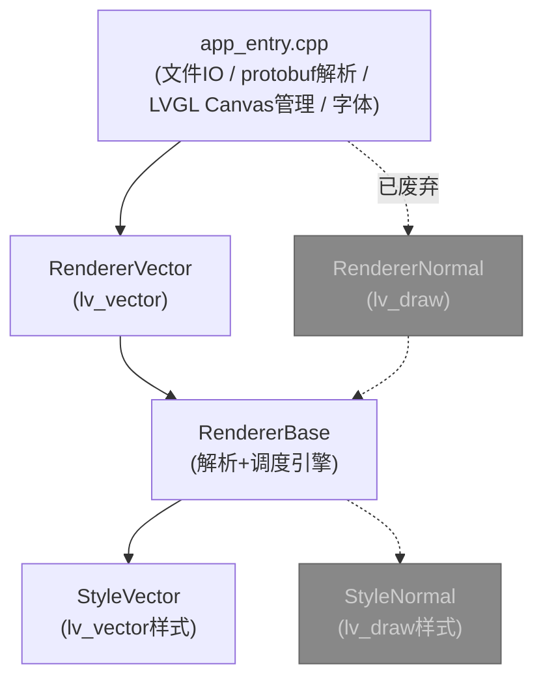
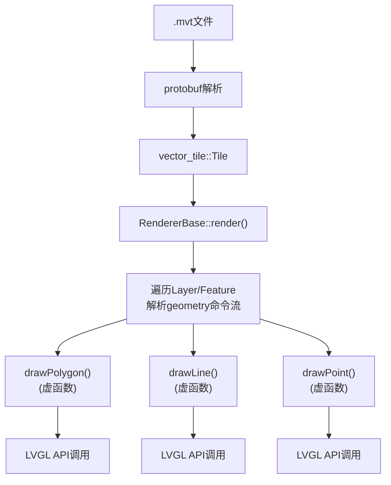
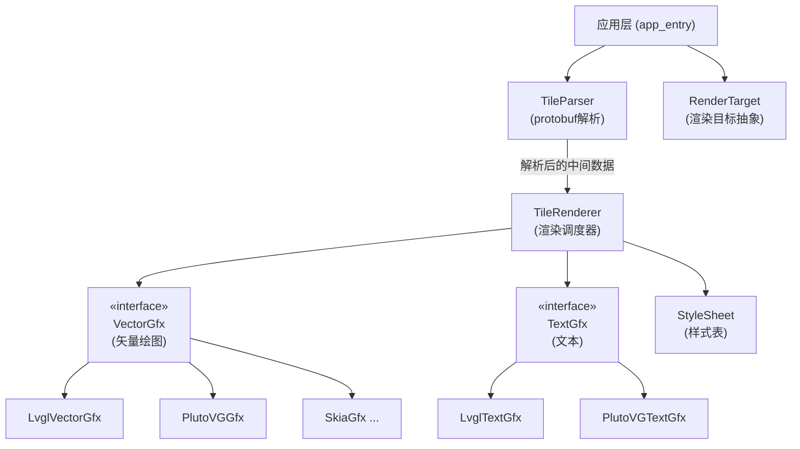

# 矢量地图渲染引擎解耦设计方案

## 1. 现状分析

### 1.1 当前架构总览

项目采用三层架构：



### 1.2 类职责说明

| 类 | 文件 | 职责 |
|---|---|---|
| `RendererBase` | MapTileRenderer.h/cpp | 遍历protobuf Tile结构，解析geometry命令流，调度虚函数 |
| `RendererVector` | MapTileRendererVector.h/cpp | 使用LVGL Vector API (`lv_vector_*`) 实现矢量绘制 |
| ~~`RendererNormal`~~ | ~~MapTileRendererNormal.h/cpp~~ | ~~使用LVGL基础绘图API (`lv_draw_rect/line/label`) 模拟矢量绘制，无真正多边形填充能力，废弃~~ |
| `StyleBase` | MapTileStyle.h | 样式查询接口基类，通过 `void*` 传递渲染器特定的描述符 |
| `StyleVector` | MapTileStyleVector.h/cpp | 直接操作 `lv_vector_dsc_t*` 设置矢量样式 |
| ~~`StyleNormal`~~ | ~~MapTileStyleNormal.h/cpp~~ | ~~与 StyleVector 逻辑几乎完全重复，废弃~~ |
| `Utils` | MapTileUtils.h/cpp | protobuf geometry命令解析工具 |

### 1.3 数据流



### 1.4 耦合点深度分析

#### 耦合点 1：`RendererVector` 直接调用 LVGL Vector API

`MapTileRendererVector.cpp` 中直接使用了以下 LVGL 专有 API：

| API 类别 | 具体调用 | 用途 |
|---------|---------|------|
| 路径创建/销毁 | `lv_vector_path_create()`, `lv_vector_path_delete()` | 矢量路径生命周期 |
| 路径操作 | `lv_vector_path_move_to()`, `lv_vector_path_line_to()`, `lv_vector_path_close()` | 路径构建 |
| 路径形状 | `lv_vector_path_append_rect()`, `lv_vector_path_append_circle()` | 预定义形状 |
| 路径管理 | `lv_vector_path_clear()` | 路径重置 |
| 描述符 | `lv_vector_dsc_create()`, `lv_vector_dsc_delete()`, `lv_vector_dsc_identity()` | 绘制上下文 |
| 变换 | `lv_matrix_identity()`, `lv_matrix_scale()`, `lv_vector_dsc_set_transform()` | 坐标变换 |
| 绘制提交 | `lv_vector_dsc_add_path()`, `lv_draw_vector()` | 路径提交与渲染 |
| 文本绘制 | `lv_draw_label()`, `lv_text_get_size()` | 标签渲染 |
| 类型依赖 | `lv_layer_t*`, `lv_font_t*`, `lv_vector_dsc_t*`, `lv_vector_path_t*`, `lv_fpoint_t`, `lv_area_t`, `lv_matrix_t` | LVGL专有类型 |

#### 耦合点 2：`StyleVector` 直接操作 LVGL 描述符

`MapTileStyleVector.cpp` 中通过 `void*` 强转为 LVGL 类型后直接操作：

```cpp
// 典型耦合代码
auto vectorDsc = (lv_vector_dsc_t*)dsc;
lv_vector_dsc_set_fill_color(vectorDsc, lv_color_make(200, 221, 151));
lv_vector_dsc_set_fill_opa(vectorDsc, LV_OPA_COVER);
lv_vector_dsc_set_stroke_width(vectorDsc, valueMapping(zoom, 5, 0.5, 12, 3, 18, 30));
lv_vector_dsc_set_stroke_color(vectorDsc, lv_color_hex(0xFFFFFF));
```

涉及的 LVGL 样式 API：
- `lv_vector_dsc_set_fill_color()` / `lv_vector_dsc_set_fill_opa()`
- `lv_vector_dsc_set_stroke_color()` / `lv_vector_dsc_set_stroke_opa()` / `lv_vector_dsc_set_stroke_width()`
- `lv_color_make()` / `lv_color_hex()` / `lv_color_mix()`
- `LV_OPA_TRANSP` / `LV_OPA_COVER` / `LV_OPA_0` / `LV_OPA_100` 等常量

#### 耦合点 3：`RendererBase` 与 protobuf 的紧耦合

`RendererBase` 同时承担了两个职责：
1. **protobuf 数据遍历**：遍历 `Tile_Layer`、`Tile_Feature`，调用 `Utils::parseGeometryCmd()` 解析 geometry 命令流
2. **渲染调度**：通过虚函数 `drawPolygon(RENDER_CMD, Arguments_t*)` 分发绘制命令

这意味着如果要支持非 protobuf 的矢量瓦片格式（如 GeoJSON），也需要修改 `RendererBase`。

#### 耦合点 4：`StyleBase` 接口使用 `void*` 传递渲染器描述符

```cpp
virtual bool getFillStyle(const vector_tile::Tile_Layer& layer, const FeatureProp& prop, float zoom, void* dsc);
```

`void* dsc` 实际上是渲染器特定的类型（`lv_vector_dsc_t*` 或 `lv_draw_rect_dsc_t*`），这导致：
- Style 和 Renderer 必须配对使用（StyleVector 只能配 RendererVector）
- 无法在编译期检查类型安全
- Style 的实现直接依赖渲染引擎的 API

#### 耦合点 5：`RendererNormal` 与 `RendererVector` 大量重复代码（已决定废弃 RendererNormal）

两个 Renderer 的 `drawRoadLabel()`、`drawPoiLabel()` 实现几乎完全相同（包括 `getPoiLabelIcon()` 函数被复制了两份），说明文本渲染逻辑没有被正确抽象。

此外 `RendererNormal` 使用 `lv_draw_rect` / `lv_draw_line` 基础图元模拟矢量渲染，无法实现真正的多边形填充。地图中大量存在凹多边形、带孔洞多边形（湖中岛、建筑内院等），这些需要 winding rule 和正确的轮廓方向处理，加上抗锯齿和贝塞尔曲线支持，实质上就是一个完整的矢量光栅化引擎——这正是 LVGL Vector / PlutoVG / ThorVG 等库的本职工作。自行实现没有意义，因此 `RendererNormal` 和 `StyleNormal` 在本次重构中直接废弃。

#### 耦合点 6：`app_entry.cpp` 中文件IO和protobuf解析与LVGL紧耦合

```cpp
// 使用 LVGL 文件系统读取 .mvt 文件
lv_fs_open(&f, filePath, LV_FS_MODE_RD);
// 使用 LVGL 内存分配
void* buf = lv_malloc(length);
// protobuf 解析
vector_tile::Tile tile;
tile.ParseFromArray(buf, length);
// 使用 LVGL Canvas 作为渲染目标
lv_canvas_init_layer(canvas, &layer);
renderer.setLayer(&layer);
```

## 2. 设计目标

1. **矢量瓦片解析** 与 **矢量渲染引擎** 完全解耦，通过抽象接口连接
2. 可以零代码修改地切换渲染后端（LVGL Vector / PlutoVG / 其他）
3. **样式系统** 与渲染引擎解耦，样式描述使用引擎无关的中间表示
4. 废弃 `RendererNormal`（基础图元无法实现真正的多边形填充），统一走矢量渲染路径
5. 最小化改动范围，渐进式重构

## 3. 整改方案

### 3.1 目标架构



### 3.2 核心抽象接口设计

#### 3.2.1 引擎无关的颜色和样式类型

```cpp
// MapTile/MapTileTypes.h - 引擎无关的基础类型

namespace MapTile {

struct Color {
    uint8_t r, g, b, a;

    Color() : r(0), g(0), b(0), a(255) {}
    Color(uint8_t r, uint8_t g, uint8_t b, uint8_t a = 255) : r(r), g(g), b(b), a(a) {}

    static Color fromHex(uint32_t hex) {
        return Color((hex >> 16) & 0xFF, (hex >> 8) & 0xFF, hex & 0xFF);
    }

    static Color mix(const Color& c1, const Color& c2, uint8_t ratio) {
        return Color(
            (c1.r * ratio + c2.r * (255 - ratio)) / 255,
            (c1.g * ratio + c2.g * (255 - ratio)) / 255,
            (c1.b * ratio + c2.b * (255 - ratio)) / 255,
            (c1.a * ratio + c2.a * (255 - ratio)) / 255
        );
    }
};

struct PointF {
    float x, y;
};

struct RectF {
    float x1, y1, x2, y2;
};

// 引擎无关的样式描述
struct FillStyle {
    Color color;
    uint8_t opacity;  // 0-255
    FillStyle() : opacity(255) {}
};

struct StrokeStyle {
    Color color;
    float width;
    uint8_t opacity;  // 0-255
    StrokeStyle() : width(1.0f), opacity(255) {}
};

struct LabelStyle {
    Color color;
    float fontSize;
    const char* text;
    LabelStyle() : fontSize(12.0f), text(nullptr) {}
};

} // namespace MapTile
```

#### 3.2.2 矢量绘图抽象接口 (VectorGfx)

这是整个解耦方案的核心。将 LVGL 的 `lv_vector_path_*` 和 `lv_vector_dsc_*` 抽象为引擎无关的接口：

```cpp
// MapTile/gfx/VectorGfx.h - 矢量绘图抽象接口

namespace MapTile {

class VectorGfx {
public:
    virtual ~VectorGfx() = default;

    // === 生命周期 ===
    virtual void begin() = 0;                    // 对应 onRenderLayer(BEGIN)
    virtual void end() = 0;                      // 对应 onRenderLayer(END) → lv_draw_vector()
    virtual void resetTransform(float scale) = 0; // 对应 onRenderLayer(RESET)

    // === 路径操作 ===
    virtual void pathClear() = 0;
    virtual void pathMoveTo(float x, float y) = 0;
    virtual void pathLineTo(float x, float y) = 0;
    virtual void pathClose() = 0;
    virtual void pathAddRect(float x1, float y1, float x2, float y2) = 0;
    virtual void pathAddCircle(float cx, float cy, float rx, float ry) = 0;

    // === 样式设置 ===
    virtual void setFillColor(const Color& color) = 0;
    virtual void setFillOpacity(uint8_t opa) = 0;
    virtual void setStrokeColor(const Color& color) = 0;
    virtual void setStrokeWidth(float width) = 0;
    virtual void setStrokeOpacity(uint8_t opa) = 0;

    // === 绘制提交 ===
    virtual void fillPath() = 0;                 // 对应 lv_vector_dsc_add_path()
};

} // namespace MapTile
```

#### 3.2.3 文本绘图抽象接口 (TextGfx)

将文本渲染从矢量绘图中分离，因为文本渲染的 API 差异通常比矢量路径更大：

```cpp
// MapTile/gfx/TextGfx.h - 文本绘图抽象接口

namespace MapTile {

struct TextMetrics {
    float width;
    float height;
};

class TextGfx {
public:
    virtual ~TextGfx() = default;

    virtual void drawLabel(float x, float y, const char* text,
                           const Color& color, float maxWidth = 0) = 0;
    virtual void drawIcon(float x, float y, const char* icon,
                          const Color& color) = 0;
    virtual TextMetrics measureText(const char* text, float maxWidth = 0) = 0;
};

} // namespace MapTile
```

#### 3.2.4 LVGL Vector 后端实现

```cpp
// MapTile/gfx/LvglVectorGfx.h

#include "VectorGfx.h"
#include "lvgl/lvgl.h"

namespace MapTile {

class LvglVectorGfx : public VectorGfx {
public:
    LvglVectorGfx(lv_layer_t* layer);
    ~LvglVectorGfx();

    // VectorGfx 接口实现
    void begin() override;
    void end() override;
    void resetTransform(float scale) override;

    void pathClear() override;
    void pathMoveTo(float x, float y) override;
    void pathLineTo(float x, float y) override;
    void pathClose() override;
    void pathAddRect(float x1, float y1, float x2, float y2) override;
    void pathAddCircle(float cx, float cy, float rx, float ry) override;

    void setFillColor(const Color& color) override;
    void setFillOpacity(uint8_t opa) override;
    void setStrokeColor(const Color& color) override;
    void setStrokeWidth(float width) override;
    void setStrokeOpacity(uint8_t opa) override;

    void fillPath() override;

private:
    lv_layer_t* _layer;
    lv_vector_dsc_t* _vectorDsc;
    lv_vector_path_t* _vectorPath;
};

} // namespace MapTile
```

#### 3.2.5 PlutoVG 后端实现（示例骨架）

```cpp
// MapTile/gfx/PlutoVGGfx.h

#include "VectorGfx.h"
#include <plutovg.h>

namespace MapTile {

class PlutoVGGfx : public VectorGfx {
public:
    PlutoVGGfx(plutovg_surface_t* surface);
    ~PlutoVGGfx();

    void begin() override {
        _context = plutovg_create(_surface);
    }

    void end() override {
        plutovg_destroy(_context);
        _context = nullptr;
    }

    void resetTransform(float scale) override {
        plutovg_scale(_context, scale, scale);
    }

    void pathClear() override {
        plutovg_new_path(_context);
    }

    void pathMoveTo(float x, float y) override {
        plutovg_move_to(_context, x, y);
    }

    void pathLineTo(float x, float y) override {
        plutovg_line_to(_context, x, y);
    }

    void pathClose() override {
        plutovg_close_path(_context);
    }

    void setFillColor(const Color& color) override {
        _fillColor = color;
    }

    void setFillOpacity(uint8_t opa) override {
        _fillOpacity = opa;
    }

    void fillPath() override {
        plutovg_set_rgba(_context,
            _fillColor.r / 255.0, _fillColor.g / 255.0,
            _fillColor.b / 255.0, _fillOpacity / 255.0);
        plutovg_fill(_context);
    }

    // ... 其余方法类似

private:
    plutovg_surface_t* _surface;
    plutovg_t* _context;
    Color _fillColor;
    Color _strokeColor;
    uint8_t _fillOpacity;
    float _strokeWidth;
    uint8_t _strokeOpacity;
};

} // namespace MapTile
```

### 3.3 样式系统重构

#### 3.3.1 问题

当前 `StyleBase` 的接口通过 `void*` 传递渲染器描述符：

```cpp
virtual bool getFillStyle(const Tile_Layer& layer, const FeatureProp& prop, float zoom, void* dsc);
```

`StyleVector::getFillStyle()` 内部直接将 `void*` 强转为 `lv_vector_dsc_t*` 并调用 LVGL API。这意味着每换一个渲染引擎，就需要写一套新的 Style 实现，即使样式逻辑（颜色值、线宽映射规则）完全相同。

#### 3.3.2 方案：样式系统输出引擎无关的样式描述

将 `StyleBase` 改为输出引擎无关的 `FillStyle` / `StrokeStyle` / `LabelStyle`，由 Renderer 负责将这些样式应用到具体的渲染引擎：

```cpp
// MapTile/MapTileStyle.h - 重构后

namespace MapTile {

class StyleBase {
public:
    virtual ~StyleBase() = default;

    virtual bool getFeatureShowable(const std::string& layerName,
                                     const FeatureProp& prop, float zoom) { return false; }
    virtual bool getLabelShowable(const std::string& layerName,
                                   const FeatureProp& prop, float zoom) { return false; }

    // 输出引擎无关的样式描述
    virtual bool getBackgroundStyle(float zoom, FillStyle& style) { return false; }
    virtual bool getFillStyle(const std::string& layerName,
                               const FeatureProp& prop, float zoom, FillStyle& style) { return false; }
    virtual bool getStrokeStyle(const std::string& layerName,
                                 const FeatureProp& prop, float zoom, StrokeStyle& style) { return false; }
    virtual bool getPointStyle(const std::string& layerName,
                                const FeatureProp& prop, float zoom, FillStyle& style) { return false; }
    virtual bool getLabelStyle(const std::string& layerName,
                                const FeatureProp& prop, float zoom, LabelStyle& style) { return false; }
};

} // namespace MapTile
```

这样做的好处：
- **一套 Style 实现适配所有渲染引擎**：`StyleVector` 和 `StyleNormal` 中大量重复的样式逻辑（颜色值、zoom映射规则、showable判断）可以合并为一个 `MapStyle` 类
- **Style 不再依赖任何渲染引擎头文件**：不需要 `#include "lvgl/lvgl.h"`
- **接口参数使用 `const std::string& layerName`** 替代 `const Tile_Layer& layer`，进一步解除对 protobuf 类型的依赖

#### 3.3.3 样式应用：由 Renderer 桥接

Renderer 从 Style 获取引擎无关的样式描述后，转换为具体引擎的 API 调用：

```cpp
// 在 TileRenderer 中
FillStyle fillStyle;
if (_style.getFillStyle(layerName, prop, _zoom, fillStyle)) {
    _gfx->setFillColor(fillStyle.color);
    _gfx->setFillOpacity(fillStyle.opacity);
}
```

### 3.4 RendererBase 拆分

#### 3.4.1 问题

当前 `RendererBase` 混合了两个职责：
1. protobuf Tile 数据遍历和 geometry 命令解析
2. 渲染调度（通过虚函数分发到子类）

#### 3.4.2 方案：拆分为 TileParser + TileRenderer

```cpp
// MapTile/TileParser.h - 纯数据解析，无渲染依赖

namespace MapTile {

// 解析后的中间表示
struct PathCommand {
    enum Type { MOVE_TO, LINE_TO, CLOSE };
    Type type;
    float x, y;  // CLOSE 时无意义
};

struct ParsedFeature {
    enum GeomType { UNKNOWN, POINT, LINE, POLYGON };
    GeomType geomType;
    std::string layerName;
    FeatureProp properties;
    std::vector<PathCommand> commands;
};

struct ParsedTile {
    std::vector<ParsedFeature> features;
    std::vector<ParsedFeature> labels;
    uint32_t extent;
};

class TileParser {
public:
    // 从 protobuf Tile 解析为中间表示
    static ParsedTile parse(const vector_tile::Tile& tile,
                            const StyleBase& style, float zoom);

    // 渲染层序列配置
    static void setLayerSequence(const char** layers);
    static void setLabelSequence(const char** labels);
};

} // namespace MapTile
```

```cpp
// MapTile/TileRenderer.h - 纯渲染调度，不依赖 protobuf

namespace MapTile {

class TileRenderer {
public:
    TileRenderer(VectorGfx& gfx, TextGfx& textGfx, StyleBase& style, float zoom);

    void setTargetSize(float size) { _targetSize = size; }
    void render(const ParsedTile& tile);

private:
    void renderFeature(const ParsedFeature& feature);
    void renderLabel(const ParsedFeature& label);

    void drawPolygon(const ParsedFeature& feature, const FillStyle& style);
    void drawLine(const ParsedFeature& feature, const StrokeStyle& style);
    void drawPoint(const ParsedFeature& feature, const FillStyle& style);
    void drawRoadLabel(const ParsedFeature& feature);
    void drawPoiLabel(const ParsedFeature& feature);

    VectorGfx& _gfx;
    TextGfx& _textGfx;
    StyleBase& _style;
    float _zoom;
    float _targetSize;
};

} // namespace MapTile
```

### 3.5 重构后的使用方式

#### 3.5.1 使用 LVGL Vector 后端

```cpp
// app_entry.cpp - 重构后

#include "MapTile/TileParser.h"
#include "MapTile/TileRenderer.h"
#include "MapTile/MapStyle.h"
#include "MapTile/gfx/LvglVectorGfx.h"
#include "MapTile/gfx/LvglTextGfx.h"

void renderTile(const char* filePath, lv_obj_t* canvas, uint32_t size, lv_font_t* font)
{
    // 1. 读取文件 + protobuf 解析（可以用标准IO替代LVGL IO）
    vector_tile::Tile tile = loadTileFromFile(filePath);

    // 2. 解析为中间表示
    MapTile::MapStyle style;
    auto parsedTile = MapTile::TileParser::parse(tile, style, 15.0f);

    // 3. 创建渲染后端
    lv_layer_t layer;
    lv_canvas_init_layer(canvas, &layer);

    MapTile::LvglVectorGfx gfx(&layer);
    MapTile::LvglTextGfx textGfx(&layer, font);

    // 4. 渲染
    MapTile::TileRenderer renderer(gfx, textGfx, style, 15.0f);
    renderer.setTargetSize(size);
    renderer.render(parsedTile);

    lv_canvas_finish_layer(canvas, &layer);
}
```

#### 3.5.2 切换为 PlutoVG 后端

```cpp
// 只需替换 Gfx 实现，其余代码不变

#include "MapTile/gfx/PlutoVGGfx.h"
#include "MapTile/gfx/PlutoVGTextGfx.h"

void renderTile(const char* filePath, uint8_t* buffer, uint32_t size)
{
    vector_tile::Tile tile = loadTileFromFile(filePath);

    MapTile::MapStyle style;
    auto parsedTile = MapTile::TileParser::parse(tile, style, 15.0f);

    // 只有这里不同：使用 PlutoVG 后端
    plutovg_surface_t* surface = plutovg_surface_create(size, size);
    MapTile::PlutoVGGfx gfx(surface);
    MapTile::PlutoVGTextGfx textGfx(surface, "/path/to/font.ttf", 12);

    MapTile::TileRenderer renderer(gfx, textGfx, style, 15.0f);
    renderer.setTargetSize(size);
    renderer.render(parsedTile);

    // 获取渲染结果
    memcpy(buffer, plutovg_surface_get_data(surface), size * size * 4);
    plutovg_surface_destroy(surface);
}
```

### 3.6 重构后的文件结构

```
MapTile/
├── MapTileDefs.h              # 基础类型定义（保留，去除protobuf依赖）
├── MapTileTypes.h             # [新增] 引擎无关的 Color/FillStyle/StrokeStyle 等
├── MapTileStyle.h             # [修改] StyleBase 接口，输出引擎无关样式
├── MapStyle.cpp/h             # [新增] 统一的样式实现（合并 StyleVector + StyleNormal）
├── TileParser.h/cpp           # [新增] protobuf 解析 → 中间表示
├── TileRenderer.h/cpp         # [新增] 渲染调度器，依赖 VectorGfx/TextGfx 接口
├── MapTileUtils.h/cpp         # 保留，protobuf geometry 解析工具
├── vector_tile.proto          # 保留
├── vector_tile.pb.h/cc        # 保留
│
├── gfx/                       # [新增] 图形抽象层
│   ├── VectorGfx.h            # 矢量绘图抽象接口
│   ├── TextGfx.h              # 文本绘图抽象接口
│   ├── LvglVectorGfx.h/cpp   # LVGL Vector API 后端
│   ├── LvglTextGfx.h/cpp     # LVGL 文本渲染后端
│   ├── PlutoVGGfx.h/cpp      # PlutoVG 后端（按需添加）
│   └── PlutoVGTextGfx.h/cpp  # PlutoVG 文本后端（按需添加）
│
├── [废弃] MapTileRenderer.h/cpp          → 拆分为 TileParser + TileRenderer
├── [废弃] MapTileRendererVector.h/cpp    → 逻辑迁移到 LvglVectorGfx
├── [废弃] MapTileRendererNormal.h/cpp    → 直接删除，基础图元无法实现多边形填充
├── [废弃] MapTileStyleVector.h/cpp       → 合并到 MapStyle
└── [废弃] MapTileStyleNormal.h/cpp       → 直接删除，与 StyleVector 逻辑重复
```

## 4. 重构步骤（建议顺序）

### Phase 1：引入引擎无关类型（无破坏性）

1. 新建 `MapTileTypes.h`，定义 `Color`、`PointF`、`RectF`、`FillStyle`、`StrokeStyle`、`LabelStyle`
2. 新建 `gfx/VectorGfx.h` 和 `gfx/TextGfx.h` 抽象接口
3. 此阶段不修改任何现有代码，只新增文件

### Phase 2：实现 LVGL 后端

4. 新建 `gfx/LvglVectorGfx.h/cpp`，将 `RendererVector` 中的 LVGL 调用迁移过来
5. 新建 `gfx/LvglTextGfx.h/cpp`，将文本渲染逻辑（`drawRoadLabel`/`drawPoiLabel`）迁移过来
6. 编写单元测试验证 LVGL 后端行为与原实现一致

### Phase 3：重构样式系统

7. 修改 `StyleBase` 接口，输出引擎无关的样式描述
8. 新建 `MapStyle.cpp/h`，合并 `StyleVector` 和 `StyleNormal` 的样式逻辑
9. 去除 Style 对 `lvgl/lvgl.h` 和 `vector_tile.pb.h` 的直接依赖

### Phase 4：拆分 RendererBase

10. 新建 `TileParser.h/cpp`，将 protobuf 遍历和 geometry 解析逻辑从 `RendererBase` 中提取
11. 新建 `TileRenderer.h/cpp`，实现基于 `VectorGfx`/`TextGfx` 接口的渲染调度
12. 更新 `app_entry.cpp` 使用新的 API

### Phase 5：清理

13. 删除 `RendererVector`、`RendererNormal`、`StyleVector`、`StyleNormal`（其中 `RendererNormal` 和 `StyleNormal` 直接删除，不做迁移）
14. 更新 CMakeLists.txt

### Phase 6：添加 PlutoVG 后端（可选）

15. 新建 `gfx/PlutoVGGfx.h/cpp`
16. 新建 `gfx/PlutoVGTextGfx.h/cpp`
17. 在 CMakeLists.txt 中添加 PlutoVG 依赖和编译选项

## 5. 关键设计决策说明

### 5.1 为什么引入中间表示 (ParsedTile) 而不是直接在渲染时遍历 protobuf？

- **解耦彻底**：`TileRenderer` 完全不依赖 protobuf，可以接受任何来源的矢量数据
- **可测试性**：可以手动构造 `ParsedTile` 来测试渲染逻辑
- **性能**：解析一次，可以多次渲染（不同缩放级别、不同渲染后端）
- **代价**：额外的内存拷贝。对于嵌入式场景如果内存敏感，可以考虑保留流式解析模式作为可选路径

### 5.2 为什么将 VectorGfx 和 TextGfx 分开？

- 矢量路径绘制和文本渲染的 API 差异很大
- 有些渲染引擎（如 PlutoVG）不内置文本渲染，需要配合 FreeType 等库
- 分开后可以独立替换，比如矢量用 PlutoVG，文本仍用 LVGL

### 5.3 为什么合并 StyleVector 和 StyleNormal？

当前两个 Style 类的样式逻辑（颜色值、zoom映射、showable判断）几乎完全相同，唯一区别是操作的 LVGL 类型不同。重构后 Style 输出引擎无关的样式描述，不再需要两套实现。

### 5.4 为什么废弃 RendererNormal？

`RendererNormal` 用 `lv_draw_rect` / `lv_draw_line` 基础图元模拟矢量渲染，无法实现真正的多边形填充。地图数据中大量存在凹多边形和带孔洞多边形（湖中岛、建筑内院），正确处理这些需要：

- 凹多边形：扫描线 + 边交叉 + 奇偶/winding rule
- 带孔洞多边形：正确的轮廓方向处理
- 抗锯齿：亚像素覆盖率计算
- 贝塞尔曲线：曲线展平或直接光栅化

这些加起来就是一个完整的矢量光栅化引擎，正是 LVGL Vector / PlutoVG / ThorVG 的本职工作。自行实现成本高且无必要，直接废弃。

## 6. 风险与注意事项

| 风险 | 影响 | 缓解措施 |
|------|------|---------|
| 中间表示的内存开销 | 嵌入式设备内存有限 | 可选：保留流式解析模式，通过编译宏切换 |
| VectorGfx 接口不够通用 | 新引擎可能需要接口扩展 | 接口设计偏保守，只抽象已知需求；预留扩展点 |
| 文本渲染差异大 | 不同引擎的字体加载/度量方式差异大 | TextGfx 接口保持最小化，复杂逻辑留给实现 |
| 重构过程中的回归 | 渲染结果可能与原实现不一致 | 使用截图对比测试，逐步迁移 |
