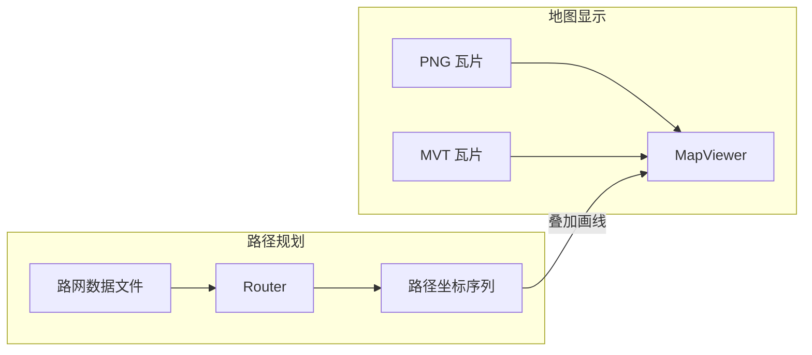

# 设备端路径规划设计方案

## 1. 目标

在嵌入式设备上实现离线自行车路径规划，基于 OpenStreetMap 免费路网数据，内存占用 < 512KB RAM。

## 2. 与地图渲染的关系

路径规划和地图渲染完全解耦：



Router 输出一组经纬度坐标，MapViewer 在地图上画线。不管地图用 PNG 还是 MVT 都行。

## 3. 数据源：OpenStreetMap

### 3.1 免费数据获取

| 来源 | 格式 | 说明 |
|------|------|------|
| [Geofabrik](https://download.geofabrik.de) | `.osm.pbf` | 按国家/区域提供 OSM 数据提取，每日更新，免费 |
| [BRouter segments](https://brouter.de/brouter/segments4/) | `.rd5` | 预处理好的路网分块数据，5°×5° 网格，全球覆盖，免费 |
| [Overpass API](https://overpass-api.de) | XML/JSON | 在线查询 OSM 数据，可按 bbox 提取道路 |

### 3.2 推荐方案：自定义路网提取

从 Geofabrik 的 `.osm.pbf` 提取路网，转换为自定义的轻量二进制格式。原因：
- BRouter 的 `.rd5` 格式是 Java 专用，解析复杂
- OSRM 的预处理数据太大（需要 GB 级内存）
- 自定义格式可以针对嵌入式优化，最小化内存和存储

## 4. 路网数据格式设计

### 4.1 分块策略

路网按瓦片分块，和地图瓦片对齐，使用 Z10 级别的网格（每块约 40km × 40km）：

```
routing/
├── 10/
│   ├── 842/
│   │   ├── 387.rng    (routing network graph)
│   │   └── 388.rng
│   └── 843/
│       ├── 387.rng
│       └── 388.rng
```

选择 Z10 的原因：
- 北京五环内约 4 个块，每块几十 KB
- 块足够大，A* 搜索时跨块次数少
- 块足够小，单块可以完整加载到 RAM

### 4.2 二进制文件格式 (.rng)

```
┌─────────────────────────────────────┐
│ Header (32 bytes)                    │
│   magic: "RNG1" (4 bytes)           │
│   version: uint16                   │
│   header_size: uint16 (=32)         │
│   node_count: uint32                │
│   edge_count: uint32                │
│   border_count: uint32              │
│   bbox: int32 × 4 (minLon,minLat,  │
│          maxLon,maxLat, 1e7 精度)    │
├─────────────────────────────────────┤
│ Node Table (node_count × 12 bytes)  │
│   lon: int32 (度 × 1e7)            │
│   lat: int32 (度 × 1e7)            │
│   first_edge: uint32 (边表索引)     │
├─────────────────────────────────────┤
│ Edge Table (edge_count × 12 bytes)  │
│   target_node: uint32              │
│   distance: uint16 (米, max 65km)  │
│   flags: uint16                     │
│     bit 0: oneway                  │
│     bit 1-3: road_class (0-7)      │
│     bit 4-5: surface (0-3)         │
│     bit 6: is_bridge               │
│     bit 7: is_tunnel               │
│     bit 8-9: bicycle_access (0-3)  │
│     bit 10-15: reserved            │
│   elevation_gain: int16 (米)       │
│   next_edge: uint16 (同源点下一条边 │
│     的偏移, 0xFFFF=最后一条)        │
├─────────────────────────────────────┤
│ Border Nodes (border_count × 16)    │
│   entries: [node_id: uint32,        │
│             tile_x: uint16,         │
│             tile_y: uint16,         │
│             remote_node_id: uint32, │
│             remote_edge: uint32]    │
└─────────────────────────────────────┘
```

**相比原方案的调整：**

1. **Header 扩展到 32 字节**：增加 `version`、`header_size`、`border_count` 字段。`header_size` 使格式可前向兼容——老版本解析器遇到新版本文件时可以跳过不认识的 header 字段。

2. **Node 的 `edge_offset` 改为 `first_edge` 索引**：原方案用字节偏移，改为边表数组索引更安全（不依赖 edge 结构体大小），也方便调试。

3. **Edge 增加 `next_edge` 链表字段**：原方案隐含假设"同一节点的边在边表中连续存放"，这要求提取工具严格排序且不能有空洞。改用显式链表（`next_edge` 存同源点下一条边的索引偏移），解耦了存储顺序和遍历顺序，提取工具实现更简单，也方便后续增量更新。代价是 edge 从 10 字节变成 12 字节（对齐到 4 字节边界，本来也会 pad）。

4. **Border Node 条目扩展**：增加 `remote_edge` 字段，记录远端块中对应边的索引。这样跨块时不需要在远端块中线性搜索匹配节点，直接跳转。

### 4.3 跨块连接

道路在块边界处被切断，需要 Border Nodes 表记录跨块连接：

```
块 A 的 border node 42 → 连接到块 B (843/387) 的 node 17, edge 5
```

A* 搜索到 border node 时，按需加载相邻块。

### 4.4 道路分类（自行车优化）

```
road_class:
  0 = motorway (禁止自行车)
  1 = trunk (不推荐)
  2 = primary (可骑行，车多)
  3 = secondary (推荐)
  4 = tertiary (推荐)
  5 = residential (推荐)
  6 = cycleway (最优)
  7 = path/track (视路面而定)

bicycle_access:
  0 = no (禁止)
  1 = dismount (需下车推行)
  2 = yes (允许)
  3 = designated (自行车专用)

surface:
  0 = paved (铺装)
  1 = unpaved (未铺装)
  2 = gravel (碎石)
  3 = unknown
```

## 5. 路由算法

### 5.1 A* 算法

基础算法，适合中短距离（< 50km）路径规划：

```cpp
// maptile/include/maptile/router.h

namespace MapTile {

struct RoutePoint {
    double lon;
    double lat;
};

struct RouteResult {
    std::vector<RoutePoint> path;
    uint32_t distance_m;     // 总距离（米）
    int32_t elevationGain;   // 总爬升（米）
    bool found;              // 是否找到路径
};

class Router {
public:
    Router();
    ~Router();

    /// 设置路网数据目录路径格式
    /// @param pathFormat  stdio 格式，如 "example/resource/routing/%d/%d/%d.rng"
    void setDataPath(const char* pathFormat);

    /// 设置 LRU cache 大小（块数）
    void setCacheSize(int maxBlocks);

    /// 计算路径
    /// @param from  起点经纬度
    /// @param to    终点经纬度
    /// @return      路径结果，found=false 表示无法到达
    RouteResult findRoute(const RoutePoint& from, const RoutePoint& to);

private:
    struct Impl;
    Impl* _impl;
};

} // namespace MapTile
```

**相比原方案的调整：**

1. **RoutePoint 改用 `double lon/lat`**：原方案用 `int32_t` 的 1e7 精度定点数。改为 double 的理由：
   - 与 MapViewer 现有接口一致（`setFocus(double lon, double lat)`、`MapConv::getCoordinate(double, double)`）
   - 避免调用方在 double 和 int32 之间反复转换
   - 内部存储和计算仍可用定点数，转换在 Router 边界完成
   - C++14 + float 已启用（`LV_USE_FLOAT=1`），double 不是问题

2. **RouteResult 增加 `found` 字段**：原方案用 `path.empty()` 判断是否找到路径，但空路径也可能是起终点重合。显式 bool 更清晰。`distance` 改名 `distance_m` 明确单位。

3. **Pimpl 模式**：Router 用 `Impl*` 隐藏实现细节，避免 header 暴露内部数据结构（LRU cache、A* 状态等），减少编译依赖。

### 5.2 内存模型

```
┌─ Block Cache (LRU) ─────────────────┐
│ 桌面/模拟器: 8 块, 每块 ~500KB      │
│ 嵌入式:      2-4 块, 每块 ~500KB    │
├─ A* 运行时 (按需分配，搜索完释放) ──┤
│ Open Set (二叉堆)                    │
│   最大 ~4000 节点 × 16B = 64KB      │
│ Node State (per-block 数组)          │
│   g_score + parent + flags           │
│   每块 ~80KB，活跃 4 块 = 320KB     │
├─────────────────────────────────────┤
│ A* 运行时总计: ~400KB RAM           │
└─────────────────────────────────────┘
```

**相比原方案的调整：**

- 去掉了独立的 Closed Set 位图，改为在 Node State 数组中用 flag 位标记。减少一次间接寻址，也少维护一个数据结构。
- Node State 合并了 g_score、parent_node、parent_edge、closed flag 到一个结构体中，提高缓存局部性。
- 明确标注"搜索完释放"——A* 运行时内存不是常驻的，只在 `findRoute()` 调用期间存在。

### 5.3 自行车权重函数

```cpp
float edgeCost(const Edge& e) {
    float base = (float)e.distance;

    // 自行车通行权限（先判断，快速剪枝）
    if (e.bicycle_access == NO || e.road_class == MOTORWAY)
        return INFINITY;

    // 道路类型偏好
    static const float classWeight[] = {
        999.0f, // motorway: 已被上面拦截
        3.0f,   // trunk: 不推荐
        1.5f,   // primary
        1.1f,   // secondary
        1.0f,   // tertiary
        1.0f,   // residential
        0.8f,   // cycleway: 最优
        1.3f,   // path/track
    };
    base *= classWeight[e.road_class];

    // 路面类型
    if (e.surface == UNPAVED) base *= 1.5f;
    if (e.surface == GRAVEL)  base *= 2.0f;

    // 爬坡惩罚（自行车对爬坡敏感）
    if (e.elevation_gain > 0)
        base += (float)e.elevation_gain * 10.0f;

    // 自行车专用道加成
    if (e.bicycle_access == DESIGNATED) base *= 0.7f;

    return base;
}
```

**调整：** 把 `bicycle_access == NO` 和 `road_class == MOTORWAY` 的判断提到最前面，避免对不可达边做无意义的乘法运算。

### 5.4 A* 启发函数

```cpp
float heuristic(double lon1, double lat1, double lon2, double lat2) {
    // Equirectangular 近似距离（米）
    double dlat = (lat2 - lat1) * 111320.0;
    double dlon = (lon2 - lon1) * 111320.0 * cos(lat1 * M_PI / 180.0);
    return (float)(sqrt(dlat * dlat + dlon * dlon) * 0.8);
    // 0.8 系数保证 admissible（实际路径不会比直线短）
}
```

**相比原方案的调整：**

- 输入改为 double 度数（与 RoutePoint 一致），不再是 1e7 定点数
- 用 `111320.0 m/度` 标准常数，单位明确为米
- cos 只需要算一次（用起点纬度近似），不需要每次都算

## 6. 数据提取工具

### 6.1 Python 提取脚本

```
tools/extract_routing.py <input.osm.pbf> <output_dir> [--bbox BBOX] [--zoom ZOOM]
```

流程：
1. 解析 `.osm.pbf`（用 `osmium` 库）
2. 提取 `highway=*` 的 way，过滤出可骑行道路
3. 在交叉口处切分 way 为 edge
4. 构建节点 + 边的图
5. 按 Z10 瓦片分块
6. 处理跨块边界连接
7. 输出 `.rng` 二进制文件
8. 输出统计摘要（节点数、边数、文件大小）

### 6.2 数据获取示例

```bash
# 下载北京区域 OSM 数据（约 700MB）
wget https://download.geofabrik.de/asia/china-latest.osm.pbf

# 提取路网（北京五环范围）
python3 tools/extract_routing.py \
    china-latest.osm.pbf \
    example/resource/routing \
    --bbox "116.1,39.7,116.7,40.1" \
    --zoom 10
```

## 7. 与 MapViewer 集成

### 7.1 路径显示

MapViewer 已实现 `setRoutePath()` 接口（接受 `std::vector<RoutePoint>`），路径线叠加在瓦片上方，跟随平移和缩放。

```cpp
Router router;
router.setDataPath("example/resource/routing/%d/%d/%d.rng");
router.setCacheSize(8);

RouteResult route = router.findRoute(
    {116.40, 39.90},  // 起点
    {116.30, 39.80}   // 终点
);

if (route.found) {
    viewer->setRoutePath(route.path);
}
```

### 7.2 起终点标记（Phase 3 后续）

在路径起终点显示标记图标，用 `lv_image` 叠加在 route layer 上。

## 8. 目录结构

```
maptile/
├── include/maptile/
│   ├── router.h              ← 新增：路由引擎公开接口
│   ├── routing_graph.h       ← 新增：路网图数据结构 + .rng 加载
│   └── ... (现有文件不变)
├── src/
│   ├── router.cpp            ← 新增：A* 实现
│   ├── routing_graph.cpp     ← 新增：.rng 解析 + LRU cache
│   └── ...

tools/
├── extract_routing.py        ← 新增：OSM → .rng 提取工具

example/
├── resource/
│   ├── routing/              ← 新增：路网数据
│   │   └── 10/842/387.rng
│   └── maps/                 (现有：地图瓦片)
├── map_viewer.h/cpp          (已扩展：setRoutePath/clearRoute)
└── app_entry.cpp             (集成入口)
```

## 9. 实施步骤

### Phase 1：数据提取工具
1. 实现 `tools/extract_routing.py`，从 OSM PBF 提取路网
2. 定义 `.rng` 二进制格式（见 4.2）
3. 生成北京测试数据，验证文件大小和节点/边数量

### Phase 2：路由引擎核心
4. 实现 `RoutingGraph`：加载 `.rng` 文件，LRU cache 管理
5. 实现 A* 算法 + 自行车权重函数
6. 跨块路由支持
7. 单元测试：已知路径的正确性验证

### Phase 3：MapViewer 集成（已部分完成）
8. ~~路径线叠加显示~~ ✅ 已实现
9. 起点/终点标记
10. demo 中接入真实路由结果替换硬编码轨迹

### Phase 4：优化（可选）
11. Contraction Hierarchies 预处理（长距离加速）
12. 高程数据集成（SRTM，用于爬坡计算）

## 10. 性能预估

| 场景 | 距离 | 搜索节点数 | 耗时（100MHz MCU） | RAM |
|------|------|-----------|-------------------|-----|
| 城区短途 | 5km | ~2000 | ~100ms | 200KB |
| 城区中途 | 20km | ~8000 | ~500ms | 350KB |
| 跨区长途 | 50km | ~20000 | ~2s | 500KB |

对于自行车码表，2 秒内算出 50km 路径完全可接受。

## 附录：与现有代码的接口约定

- **坐标系**：WGS84 经纬度（double），与 `MapConv::getCoordinate()` 一致
- **文件 I/O**：stdio（`fopen/fread`），与 `MBTilesReader` 的 SQLite 直接访问模式一致，不依赖 lv_fs
- **C++ 标准**：C++14（项目已配置）
- **内存分配**：标准 `new/delete`，A* 运行时内存在 `findRoute()` 返回后释放
- **线程安全**：Router 实例非线程安全，同一实例不可并发调用 `findRoute()`
