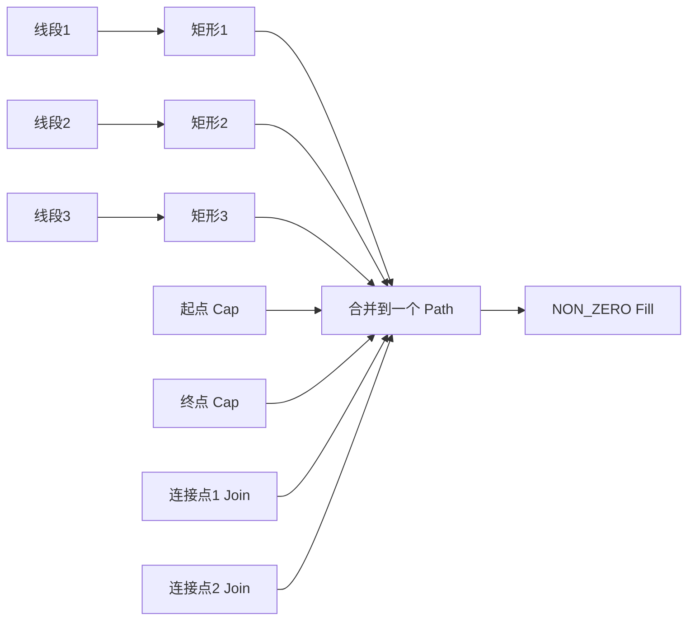
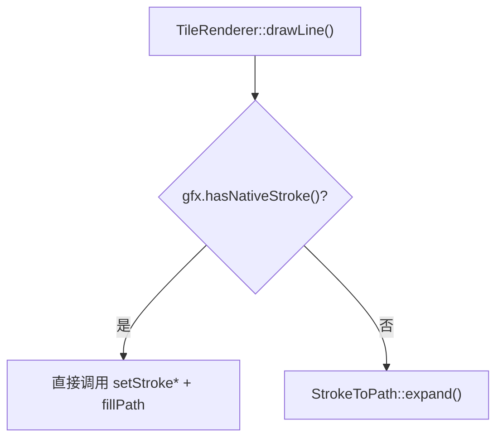

# Stroke-to-Path 算法设计方案

## 1. 问题背景

### 1.1 为什么需要 Stroke-to-Path

嵌入式 GPU（如 VeriSilicon VG-Lite）和部分矢量渲染引擎不直接支持 stroke 绘制，或者 stroke 性能远低于 fill。地图渲染中道路层（road）几乎全是 stroke，每条道路单独提交一次 stroke 调用会导致：

- GPU draw call 数量爆炸（一个 tile 可能有数百条道路）
- 每次 stroke 都需要 GPU 内部做一次 tessellation
- 无法将多条道路合并为一次 draw call

核心思路：在 CPU 端将 stroke 展开为 fill path（多边形轮廓），然后合并到一个大 path 中，用 non-zero 填充规则一次性提交给 GPU。

### 1.2 业界参考

| 方案 | 来源 | 特点 |
|------|------|------|
| GPU-friendly Stroke Expansion | [Levien & Uguray, 2024](https://arxiv.org/html/2405.00127v1) | Euler spiral 近似平行曲线，GPU compute shader 并行，精度高但复杂度高 |
| NanoVG expandStroke | [memononen/nanovg](https://github.com/memononen/nanovg) | CPU 端展开为三角形条带，适合 OpenGL，但输出是三角形而非 path |
| LVGL vg_lite line | lvgl/src/draw/vg_lite/lv_draw_vg_lite_line.c | 单线段展开为矩形+圆弧 path，用 even-odd 填充，已在生产环境验证 |
| Clipper2 InflatePaths | [AngusJohnson/Clipper2](https://github.com/AngusJohnson/Clipper2) | 通用多边形偏移库，支持 miter/bevel/round join，但依赖重 |

### 1.3 你的思路评估

> 根据 stroke 生成多个多边形合并在一个 path 里 + non-zero 填充，圆头用矩形+圆形组合

这个思路非常务实，和 LVGL vg_lite 的实现方向一致。优势：

- 避免了平行曲线（offset curve）的数学复杂度——地图数据全是折线段，没有贝塞尔曲线
- 矩形+圆形组合天然避免了端点处的缝隙问题
- non-zero 填充规则下，重叠区域不会产生空洞（even-odd 会）
- 所有线段的展开结果可以合并到一个 path，一次 draw call 搞定

## 2. 算法设计

### 2.1 输入输出

```
输入：
  - 折线段序列 [(x0,y0), (x1,y1), (x2,y2), ...]
  - 线宽 width
  - 端点样式 cap: BUTT / ROUND / SQUARE
  - 连接样式 join: MITER / BEVEL / ROUND
  - miter_limit（仅 MITER join 时有效）

输出：
  - 一个 fill path（move_to / line_to / arc / close 命令序列）
  - 使用 NON_ZERO 填充规则
```

### 2.2 核心思路：逐段展开 + 合并

不做传统的"左右偏移曲线"，而是将每个线段独立展开为一个封闭形状，然后全部追加到同一个 path 中。non-zero 填充规则保证重叠区域正确填充。



### 2.3 线段展开为矩形

对于线段 P0→P1，线宽 w：

```
    法向量 n = normalize(P1 - P0) 旋转90°
    半宽 h = w / 2

    四个顶点：
    A = P0 + n * h
    B = P0 - n * h
    C = P1 - n * h
    D = P1 + n * h

         A ─────────── D
         │             │
    P0 ──┤             ├── P1
         │             │
         B ─────────── C

    Path: move_to(A) → line_to(B) → line_to(C) → line_to(D) → close
```

### 2.4 端点处理 (Cap)

#### BUTT Cap
不做额外处理，矩形端点即为最终端点。

#### SQUARE Cap
将矩形沿线段方向向外延伸 h（半线宽）：

```
    A' = A - dir * h
    B' = B - dir * h
    （起点端）

    D' = D + dir * h
    C' = C + dir * h
    （终点端）
```

#### ROUND Cap
在端点处追加一个圆形（半径 = h），利用 non-zero 规则与矩形自然融合：

```
    Path 追加：
    move_to(P0.x + h, P0.y)
    arc(P0, h)  // 完整圆
    close

    同理处理终点 P_last
```

这比计算半圆弧简单得多——完整圆形在 non-zero 规则下与矩形重叠区域不会产生空洞，视觉效果等价于半圆 cap。

### 2.5 连接点处理 (Join)

连接点是相邻两段线段的交汇处。由于每段线段已经独立展开为矩形，连接点处会出现缝隙或重叠。

#### ROUND Join
在连接点追加一个圆形（半径 = h），填补缝隙：

```
    Path 追加：
    move_to(P_join.x + h, P_join.y)
    arc(P_join, h)  // 完整圆
    close
```

同样利用 non-zero 规则，圆形覆盖缝隙区域，与两侧矩形自然融合。

#### BEVEL Join
在连接点处，连接两个矩形的外侧顶点形成三角形：

```
    设线段1的终点外侧顶点为 D1，线段2的起点外侧顶点为 A2
    连接点为 P_join

    Path 追加：
    move_to(D1) → line_to(P_join) → line_to(A2) → close
```

#### MITER Join
延伸两个矩形的外侧边直到相交：

```
    计算交点 M（两条外侧边的延长线交点）
    如果 miter_length > miter_limit * h，退化为 BEVEL

    Path 追加：
    move_to(D1) → line_to(M) → line_to(A2) → close
```

### 2.6 为什么用圆形而不是半圆弧

传统 stroke 展开需要精确计算半圆弧的起止角度，涉及 atan2 和角度方向判断，容易出错。用完整圆形的好处：

1. 不需要计算角度，只需要圆心和半径
2. non-zero 填充规则下，圆形与矩形重叠不会产生空洞
3. 实现极其简单：`path_add_circle(cx, cy, r)`
4. 对于 GPU 来说，多一个圆形的开销远小于一次额外的 draw call

唯一的代价是多了一些重叠面积，但在 non-zero 填充下这完全不影响视觉结果。

### 2.7 完整展开流程

```
stroke_to_path(points[], width, cap, join):
    h = width / 2
    path = new Path()

    // 1. 展开每个线段为矩形
    for i in 0..n-2:
        rect = expand_segment(points[i], points[i+1], h)
        path.append(rect)

    // 2. 处理连接点
    for i in 1..n-2:
        if join == ROUND:
            path.add_circle(points[i], h)
        elif join == BEVEL:
            path.append(bevel_triangle(seg[i-1], seg[i], points[i], h))
        elif join == MITER:
            path.append(miter_or_bevel(seg[i-1], seg[i], points[i], h, miter_limit))

    // 3. 处理端点
    if cap == ROUND:
        path.add_circle(points[0], h)
        path.add_circle(points[n-1], h)
    elif cap == SQUARE:
        // 延伸首尾矩形（已在步骤1中处理）

    return path  // 使用 NON_ZERO 填充
```

### 2.8 Dash 处理

参考 LVGL vg_lite 的实现（`lv_draw_vg_lite_line.c`），dash 的原理是在矩形 body 上叠加反向矩形（gap 区域），用 even-odd 填充抠掉间隙。

对于折线段的 dash，需要沿路径累计长度来计算 dash 偏移：

```
dash_stroke_to_path(points[], width, dash_width, dash_gap):
    h = width / 2
    path = new Path()
    dash_cycle = dash_width + dash_gap
    accumulated_length = 0

    for each segment (P0 → P1):
        seg_length = distance(P0, P1)
        dir = normalize(P1 - P0)
        normal = rotate90(dir)

        // 沿线段方向，按 dash 周期切割
        offset = 0
        while offset < seg_length:
            // 计算当前在 dash 周期中的位置
            phase = (accumulated_length + offset) % dash_cycle

            if phase < dash_width:
                // 在 dash 段内，绘制矩形
                dash_remaining = dash_width - phase
                draw_length = min(dash_remaining, seg_length - offset)
                start = P0 + dir * offset
                end = P0 + dir * (offset + draw_length)
                emit_rect(path, start, end, normal, h)
                offset += draw_length
            else:
                // 在 gap 段内，跳过
                gap_remaining = dash_cycle - phase
                offset += min(gap_remaining, seg_length - offset)

        accumulated_length += seg_length

    return path  // 使用 NON_ZERO 填充
```

### 2.9 适用范围

| 特性 | 支持情况 | 说明 |
|------|---------|------|
| 直线段折线 | ✅ 完整支持 | MVT 格式只有 MoveTo/LineTo/Close，全是直线 |
| 贝塞尔曲线 | ❌ 不支持 | 地图数据不需要，如需支持可先展平为折线 |
| Cap (Butt/Round/Square) | ✅ 完整支持 | Round 用完整圆形简化实现 |
| Join (Miter/Bevel/Round) | ✅ 完整支持 | Round 用完整圆形简化实现 |
| Dash | ✅ 支持 | 沿路径累计长度切割 |

## 3. 接口设计

### 3.1 可配置的 stroke 策略

stroke-to-path 不是所有后端都需要的。如果后端原生支持高效 stroke（如 PlutoVG、ThorVG），应该直接走后端的 stroke 实现。只有后端不支持或效率低时（如 vg_lite 硬件 GPU），才走 CPU 端的 stroke-to-path。

这个选择权交给 `VectorGfx` 后端实现：

```cpp
// VectorGfx.h

class VectorGfx {
public:
    // ... 现有接口 ...

    // 后端声明自己是否支持原生 stroke
    virtual bool hasNativeStroke() const { return true; }

    // 填充规则
    virtual void setFillRule(FillRule rule) = 0;
};
```

`TileRenderer` 根据后端能力选择路径：



### 3.2 StrokeToPath 接口

```cpp
// MapTile/StrokeToPath.h

namespace MapTile {

enum class StrokeCap { BUTT, ROUND, SQUARE };
enum class StrokeJoin { MITER, BEVEL, ROUND };

struct StrokeParams {
    float width;
    StrokeCap cap;
    StrokeJoin join;
    float miterLimit;
    float dashWidth;   // 0 = 无 dash
    float dashGap;

    StrokeParams()
        : width(1.0f)
        , cap(StrokeCap::ROUND)
        , join(StrokeJoin::ROUND)
        , miterLimit(4.0f)
        , dashWidth(0)
        , dashGap(0) {}
};

class StrokeToPath {
public:
    // 将折线段展开为 fill path 命令，追加到 gfx
    static void expand(VectorGfx& gfx,
                       const PointF* points, int count,
                       const StrokeParams& params);
};

} // namespace MapTile
```

### 3.3 与现有架构的集成

```cpp
void TileRenderer::drawLine(const ParsedFeature& feature) {
    StrokeStyle strokeStyle;
    _style.getStrokeStyle(..., strokeStyle);

    if (_gfx.hasNativeStroke()) {
        // 后端原生支持 stroke，直接用
        _gfx.pathClear();
        _gfx.setFillOpacity(0);
        _gfx.setStrokeColor(strokeStyle.color);
        _gfx.setStrokeWidth(strokeStyle.width);
        _gfx.setStrokeOpacity(strokeStyle.opacity);
        for (const auto& cmd : feature.commands) { /* pathMoveTo/LineTo/Close */ }
        _gfx.fillPath();
    } else {
        // CPU 端 stroke-to-path
        std::vector<PointF> points;
        for (const auto& cmd : feature.commands) {
            if (cmd.type == PathCommand::MOVE_TO || cmd.type == PathCommand::LINE_TO)
                points.push_back({cmd.x, cmd.y});
        }

        StrokeParams params;
        params.width = strokeStyle.width;

        _gfx.pathClear();
        _gfx.setFillColor(strokeStyle.color);
        _gfx.setFillOpacity(strokeStyle.opacity);
        _gfx.setStrokeOpacity(0);
        _gfx.setFillRule(FillRule::NON_ZERO);
        StrokeToPath::expand(_gfx, points.data(), points.size(), params);
        _gfx.fillPath();
    }
}
```

### 3.4 各后端的 hasNativeStroke 配置

| 后端 | hasNativeStroke | 原因 |
|------|----------------|------|
| PlutoVGGfx | `true` | PlutoVG 内置高质量 stroke |
| LvglVectorGfx (ThorVG/SW) | `true` | ThorVG 内置 stroke |
| LvglVectorGfx (vg_lite) | `false` | vg_lite 硬件不直接支持 stroke，但已对接 LVGL Vector API，走 LvglVectorGfx 即可，无需单独后端 |

注：vg_lite 是 LVGL 内部的 GPU 渲染后端，通过 `LvglVectorGfx` → LVGL Vector API → vg_lite 驱动的链路工作。当 LVGL 底层使用 vg_lite 时，`LvglVectorGfx` 应将 `hasNativeStroke()` 返回 `false`，由 `StrokeToPath` 在 CPU 端展开后以 fill 形式提交。可通过编译宏或运行时检测 LVGL 当前渲染后端来决定。

## 4. 性能分析

### 4.1 对比：逐条 stroke vs 合并 fill

| 指标 | 逐条 stroke | 合并 fill (本方案) |
|------|------------|-------------------|
| Draw call 数 | N（每条道路一次） | 1（所有同色道路合并） |
| GPU tessellation | 每次 stroke 都要做 | 无，CPU 已展开 |
| CPU 开销 | 低 | 中（展开计算） |
| 总体性能 | GPU 瓶颈 | CPU/GPU 均衡 |

### 4.2 进一步优化：批量合并

同色同宽的道路可以合并到一个 path 中一次提交：

```
按 (color, width) 分组 → 每组一个 path → 每组一次 draw call
```

地图中道路通常只有几种颜色和宽度组合，实际 draw call 数可以压缩到个位数。

## 5. 局限性与后续扩展

| 局限 | 说明 | 后续方案 |
|------|------|---------|
| 仅支持直线段折线 | MVT 格式只有 MoveTo/LineTo/Close，完全够用 | 如需贝塞尔曲线支持，先展平为折线再处理 |
| 圆形 cap/join 有冗余面积 | non-zero 下不影响视觉 | 如需精确轮廓（如导出 SVG），改用半圆弧 |
| 文字描边 | 文字轮廓是贝塞尔曲线 | 先用 FreeType 获取 glyph outline，展平后复用本算法 |

## 6. 验证计划

算法的核心逻辑（矩形展开 + 圆形 cap/join）参考了 LVGL vg_lite 后端的生产实现，但折线序列的连接点处理是新增的，需要验证：

1. 直角转弯（90°）：两个矩形的缝隙是否被圆形/bevel 正确填补
2. 锐角转弯（<30°）：miter 是否正确退化为 bevel
3. 钝角转弯（>150°）：矩形重叠区域在 non-zero 下是否正确
4. 闭合路径：首尾连接点的 join 处理
5. 单点/两点退化情况
6. dash 在跨线段边界时的连续性
